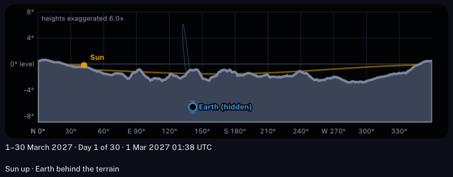
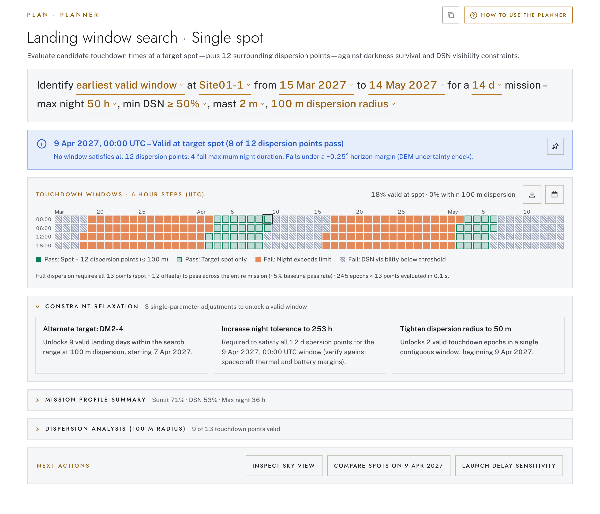

[](https://github.com/lunazen-spaceapp/lunazen-v1/actions/workflows/test.yml)

# LunaZen: Lunar Landing Site Navigator

At the lunar south pole the Sun never climbs more than a few degrees, so a ridge far away can decide whether a lander has light and a line to Earth. LunaZen shows, for a spot and a date, when the Sun and Earth are above the real terrain horizon and how long the dark lasts, and it helps you choose where and when to land. It runs entirely in your browser. A NASA Space Apps 2026 project.

- **App:** https://lunazen-v1.vercel.app
- **30-second demo:** DEMO_URL
- **User Guide:** [lunazen_guide.pdf](docs/learn/lunazen_guide.pdf), 7 pages; page 1 is a one-page summary
- **Videos:** PLAYLIST_URL (a six-part series on the south polar sky)



## What you can do

- **Ask a planning question as a sentence.** The Planner tests every landing time at a spot, and at 12 points up to 100 m around it, and answers in about a second.
- **See what would make a landing work.** Another spot, a lander that tolerates a longer night, or a tighter landing radius, each checked by the engine.
- **Re-plan when the date slips.** Delay impact shows the next valid window and the backup spots; Compare landings shifts pinned landings by any number of days.
- **Look at the real sky.** The Explorer draws the Sun and Earth on the terrain skyline, in a panorama and in 3D, with countdowns to the next sunset and Earthset and exportable visibility windows.
- **Browse the whole pole.** The Map shows NASA's sunlight and Earth-visibility maps with 13 sites and 67 spots; add your own point and save it.
- **Compare.** Rank all 67 spots for one landing, or put two to four sites side by side.
- **Go beyond the pole.** Twelve landing sites (Apollo, Chang'e, Chandrayaan-3, SLIM) with their skies beside the pole's.



## Try it

The Plan pages open on Site01-1 from 15 March 2027.

1. **Planner.** 18% of landing times are valid at the spot, but none within 100 m. Under *Constraint relaxation*, DM2-4 has 9 valid landing days from 7 April; a lander that tolerates 253 h of darkness would work; so would a 50 m radius (2 landing times, from 9 April). Press the pin icon on a landing.
2. **Compare landings.** Enter 9 days and press *Rerun pins* to see what a nine-day slip does to each pin.
3. **Delay impact.** Site01-1 is not valid on 15 March (DSN visibility is too low); the next valid window opens on 2 April, 18 days later.
4. **Explorer.** Site01-1 on 1 March 2027 at 06:15 UTC: the Sun sets in 36 h 15 min and Earth rises in 3 d 18 h.
5. **Map.** In *Plot a point*, pick a point inside a mapped site for its four figures, then *Save to My points*.

## Why you can rely on it

Each step is checked against evidence the program did not produce; the Evidence page in the app (under Resources) shows every check against its tolerance.

- Sun and Earth directions match JPL Horizons to 0.1″ (4 sites, 70 dates each).
- 18.6-year average sunlight matches NASA's LOLA maps to 1.6 percentage points RMS over 26 points.
- The seven Connecting Ridge regions of Barker et al. (2021) are reproduced to within 1.4 points.
- The Sun's angle at the Apollo 11, 12 and 14 moonwalks matches the Apollo Lunar Surface Journal to 0.12°.
- Blue Ghost 1's sunset is reproduced to about 6 minutes, and IM-1's terrain height to 15 m.
- The browser engine is tested against the Python reference on every run.

LunaZen answers geometry questions: light, darkness and line of sight. It judges a lander against a darkness limit with a source (5 h, what Blue Ghost 1 survived; 50 h, VIPER's design figure) or hours you enter, and it leaves a lander's power and thermal design to the lander's team. The guide's last sections say more.

## Run it

```bash
cd web && npm run serve        # then open http://localhost:8000/
```

Node is the only requirement. A packaged zip of the app runs with `./start.sh` (macOS, Linux) or `start.bat` (Windows). The app is best on a laptop or desktop browser and also works on phones; the 3D tab needs WebGL2. `bash scripts/build_site.sh` builds the deployable site into `public/`, and `scripts/package_web.sh` builds the zip.

## Tests

```bash
cd web && npm test                 # the browser engine against the Python fixtures, and the app helpers
uv sync && uv run pytest           # the Python tests; with Chrome installed it also drives the pages (tests/test_web_flows.py)
./scripts/fetch_data.sh            # about 2.5 GB into data/external/; enables the terrain, illumination and notebook tests
```

`uv run python pipeline/site_report.py Site01-1 2027-01-01 2028-01-01` is the Explorer on the command line (Sun up 89.7% of the year, Earth 55.2%, longest night 138 h). Two notebooks in `notebooks/` follow the method step by step (`uv run jupyter lab`, after fetching the data).

## Repository

| Folder | What is in it |
|---|---|
| `lunazen/` | The Python reference: SPICE geometry, terrain horizons, visibility, DSN, missions, ranking |
| `web/` | The app: pages (`*.html`), scripts (`app/`), the browser engine (`engine/`) and its data (`data/`) |
| `pipeline/`, `validation/` | The offline builds that turn NASA data into the app's data, and the checks against independent sources |
| `data/` | Site definitions with sources and small precomputed products (`external/` is downloaded and git-ignored) |
| `tests/`, `scenarios/` | The Python tests, including the browser flows, and a re-runnable slipped-landing walkthrough |
| `notebooks/`, `docs/` | The notebooks, and the User Guide with its figure and screenshot scripts |
| `scripts/`, `packaging/` | Data download, the site build and the downloadable zip |

## Use of AI

Space Apps 2026 asks every team to describe its use of AI tools. We used Anthropic's Claude in these ways:

- **Code and documentation:** Claude Code [wrote / co-wrote] the Python reference, the browser engine and app, the tests and the guide, working from our design, decisions and reviews. [`CLAUDE.md`](CLAUDE.md) is the guide we gave it.
- **Review and testing:** Claude reviewed and tested the app in the browser against the challenge statement, and suggested fixes.
- **Videos:** [describe how the video series and the demo were made, including any AI narration or visuals].

Every number the app shows is computed by the engine from NASA data and checked against independent sources, so the results do not depend on trusting the AI that wrote the code.

[Add what the team did: the choices, checks and decisions that were yours.]

## Team

TEAM

No names, voices or faces of anyone under 18 appear in the app, the guide or the videos.

## Licence and credits

- The code is under the [MIT licence](LICENSE). The documentation (the guide, its figures and the notebooks' prose) is under [CC BY 4.0](LICENSE-docs).
- NASA data is used under NASA's public-domain and open-data terms. Not endorsed by NASA; no NASA logo or mission patch is used.
- The bundled fonts, Jost and Public Sans (`web/app/fonts/`), are under the SIL Open Font License 1.1; the licence texts are next to the fonts.
- Data sources: NASA/JPL NAIF SPICE kernels (DE440, lunar frames); LRO LOLA elevation models (PDS, via the MIT LOLA mirror); NASA PGDA 5 m candidate-site maps (Barker et al. 2021); SLDEM2015 terrain (LOLA and Kaguya); LROC and NSSDCA landing positions; LOLA average illumination and Earth-visibility maps (Mazarico et al. 2011); Deep Space Network antenna positions from NASA/JPL document 810-005; JPL Horizons (validation only).
